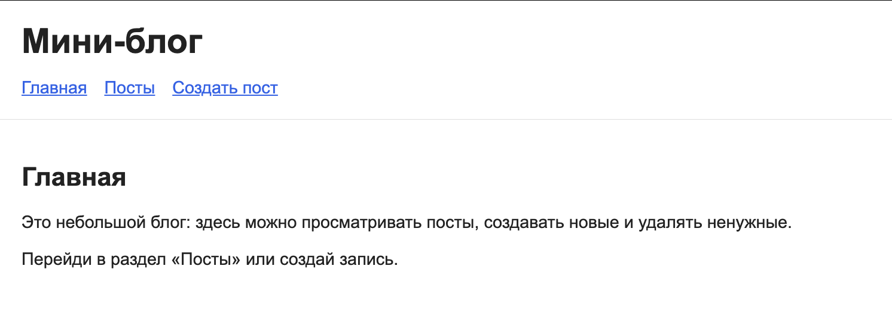

# Angular - Практика 2

Учебный мини-блог на Angular. В проекте есть маршруты, форма создания поста и список постов с локального API. Посты можно добавлять и удалять.

## Запуск

Установить зависимости:

```bash
cd Angular/work-prac-2
npm install
```

Запустить локальный API в первом терминале:

```bash
npm run start:api
```

Во втором терминале из папки проекта запустить приложение:

```bash
npm start
```

Открой [http://localhost:4200](http://localhost:4200).

Для production-сборки:

```bash
npm run build -- --configuration production
```

## Скриншоты

### Главная



### Создание поста


